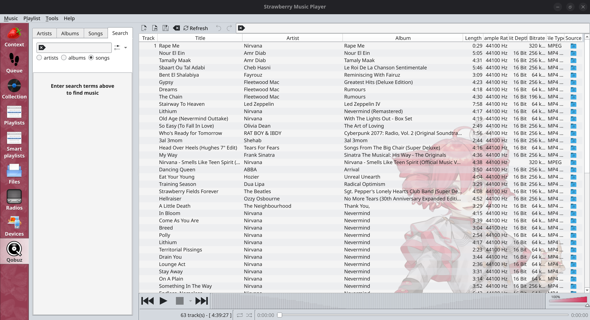

# Kasane Teto themed strawberry

A personal fork of [Strawberry Music Player](https://github.com/strawberrymusicplayer/strawberry), combining a Kasane Teto inspired appearance with a native **Refresh** button and playlist duplicate prevention.

**Version:** Strawberry **1.2.31**, Kasane Teto edition (customizations developed 2026-10-24; published 2026-10-26). Based on upstream commit `19d8c0b8ce5bae37e73c41b3552d3502217b3175`. The application's internal version remains 1.2.31.



Screenshot captured from the running Linux application on 2026-10-26.

## What's different

### Refresh button and F5 shortcut

The playlist toolbar has a visible **Refresh** button beside the existing playlist controls. Press it or **F5** to scan every configured Collection folder, including nested folders, and append available local tracks missing from the selected playlist. This synchronizes the playlist with the whole configured collection, rather than only the currently selected album or folder.

The action waits for the scan's database updates before reading the collection. During a scan it displays **Refreshing…** and disables itself to prevent overlapping requests. Existing playlist order and the playing track are preserved; repeated refreshes do not add copies. It does not remove unavailable tracks or delete or retag music files.

### Duplicate prevention

- Tracks are identified by URL plus CUE offset, preserving separate CUE tracks and different files with identical titles.
- Adding the same track again reuses its existing playlist entry for play and queue requests.
- Existing duplicate references are removed when a playlist loads and when Refresh completes, retaining the current or last-played instance where applicable.
- Cross-playlist additions also use the duplicate checks. Intentionally repeating the same URL/CUE track in one playlist is therefore no longer supported through normal insertion.

### Kasane Teto theme

The theme uses Strawberry's native appearance settings, the Fusion widget style, a per-application KDE palette, Jost typography, a translucent Teto playlist background, and a custom application icon theme. The palette combines pale gray `#D4D9DF`, light gray `#E1E4E9`, near-black `#1D1D1D`, and raspberry `#D5214B`.

The theme assets and a portable setup script are included under [`teto/`](teto/). The setup creates a separate Strawberry profile and keeps the native application layout. Appearance can still be adjusted in Strawberry's settings.

## Build and apply the theme on Linux

Install the [upstream build dependencies](README.upstream.md#gear-requirements), plus Ninja. For the full theme, install your distribution's **Qt 6 KDE platform theme integration**, **Breeze icons**, Python 3, and fontconfig. Package names vary by distribution. Without KDE integration, Strawberry's own palette and background still apply, but some font and icon styling may differ.

```sh
git clone https://github.com/osama2alashry/Kasane-Teto-themed-strawberry.git
cd Kasane-Teto-themed-strawberry
sh teto/build.sh
python3 teto/install-theme.py --binary "$HOME/.local/share/strawberry-teto/app/bin/strawberry"
"$HOME/.local/share/strawberry-teto/bin/strawberry-teto"
```

Close other Strawberry instances before launching the themed profile, then add your folders in **Settings > Collection**. Use **Refresh / F5** to populate the current playlist. No personal library or service account is included.

The build helper uses Release mode and disables optional iPod support, streaming tag reader, and translations, matching the original local build. Override `TETO_BUILD_DIR`, `TETO_INSTALL_PREFIX`, or `TETO_BUILD_JOBS` as needed; use upstream CMake options for a different feature set. The theme installer also accepts `--prefix` and `--binary` for other installation locations. Reinstalling preserves the profile's existing settings and service logins.

The installer copies Jost into the user's font directory and creates the theme profile under `~/.local/share/strawberry-teto/`; it does not change the desktop-wide palette. Building alone does not apply the theme. The published repository contains source and assets, not a prebuilt binary or Flatpak package. The local installation's ignored service credentials header is not published; streaming service setup depends on your own configuration and upstream build options.

## Optional Qobuz saving helper

The original local customization also includes a separate MPRIS watcher, [`teto/qobuz-save.py`](teto/qobuz-save.py). It saves complete Qobuz tracks as playback starts, adds metadata and album artwork without re-encoding the audio, rejects incomplete downloads and previews, and skips previously saved files. It does not replace streaming playlist entries; local copies appear in Collection after their destination is scanned.

This helper is **opt-in** in the portable launcher. It needs Python `requests`, PyGObject/Gio, FFmpeg/ffprobe, and an authenticated Strawberry Qobuz configuration with the required application credentials. No credentials are bundled. To enable it for a launch:

```sh
STRAWBERRY_TETO_QOBUZ_SAVE=1 "$HOME/.local/share/strawberry-teto/bin/strawberry-teto"
```

The default destination is `~/Music/Qobuz`; add that folder to Collection. Override `STRAWBERRY_TETO_SAVE_DIR`, `STRAWBERRY_TETO_SAVE_STATE`, or `STRAWBERRY_TETO_PROFILE` as needed. The helper offers `--disable`, `--enable`, `--current`, and `--backfill-covers`; see `python3 teto/qobuz-save.py --help`. Queued saves finish after the player closes. Save only content you have permission to retain.

## Validation and scope

- **60 playlist tests passed** when rerun for publication on 2026-10-26, including refresh deduplication, playback preservation, queue reuse, CUE handling, and legacy duplicate cleanup.
- Original isolated UI validation on 2026-10-24 covered the visible button, a new nested WAV, three refreshes, repeated folder addition, and preservation of the current track.
- The original local build verified Linux MP3/M4A playback. Theme setup targets Linux; macOS and Windows have not been validated for this customization.

With upstream's test dependencies installed, build and run the playlist tests:

```sh
cmake --build build --target playlist_test
QT_QPA_PLATFORM=offscreen ./build/tests/playlist_test
```

## Credits and license

Maintained by [osama2alashry](https://github.com/osama2alashry), with **OpenAI Codex** credited as a commit coauthor. Thanks to Jonas Kvinge and all Strawberry contributors for the player this fork builds on.

Strawberry source is licensed under **GNU GPL v3**; see [COPYING](COPYING). Jost includes its SIL Open Font License. Character artwork and marks retain their owners' rights. See [asset sources and credits](teto/CREDITS.md) for TWINDRILL, the website illustration, and icon provenance. This is an unofficial fan customization.

The original project overview, features, dependencies, and support links are preserved in [README.upstream.md](README.upstream.md).
